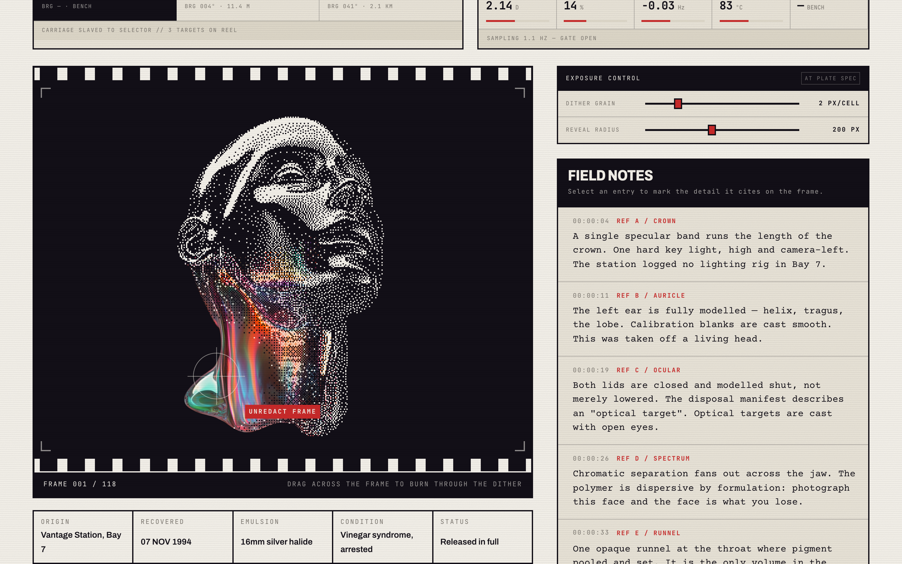
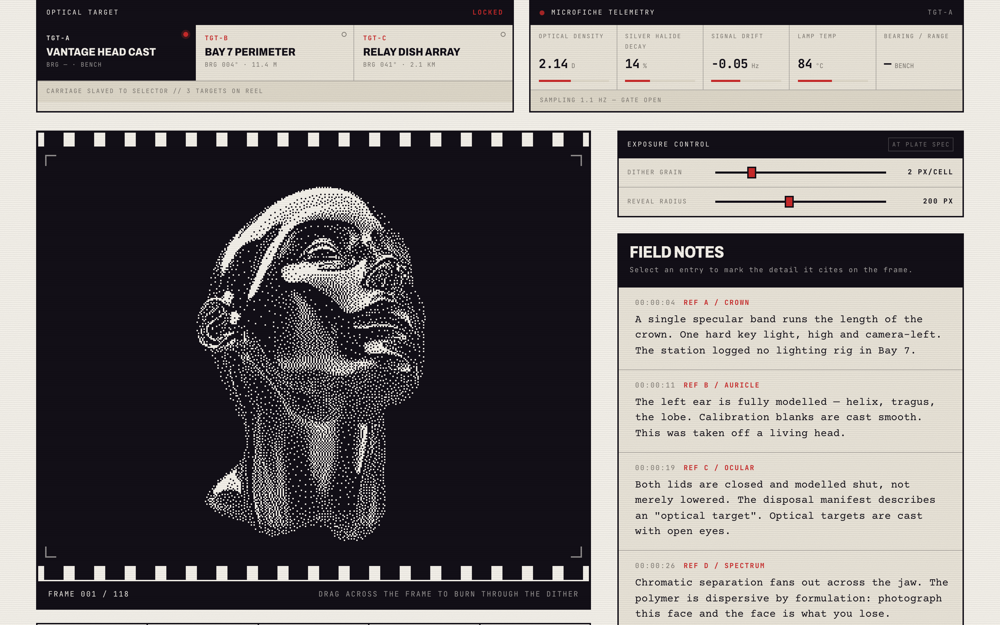
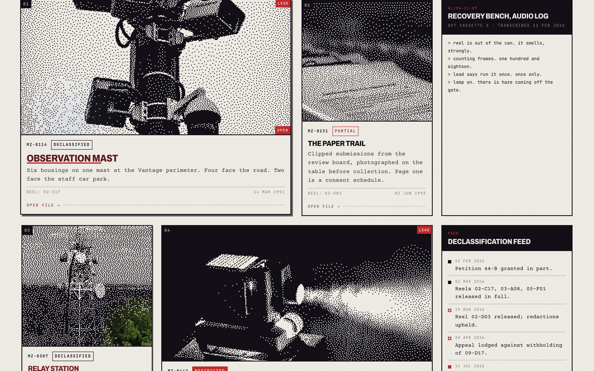
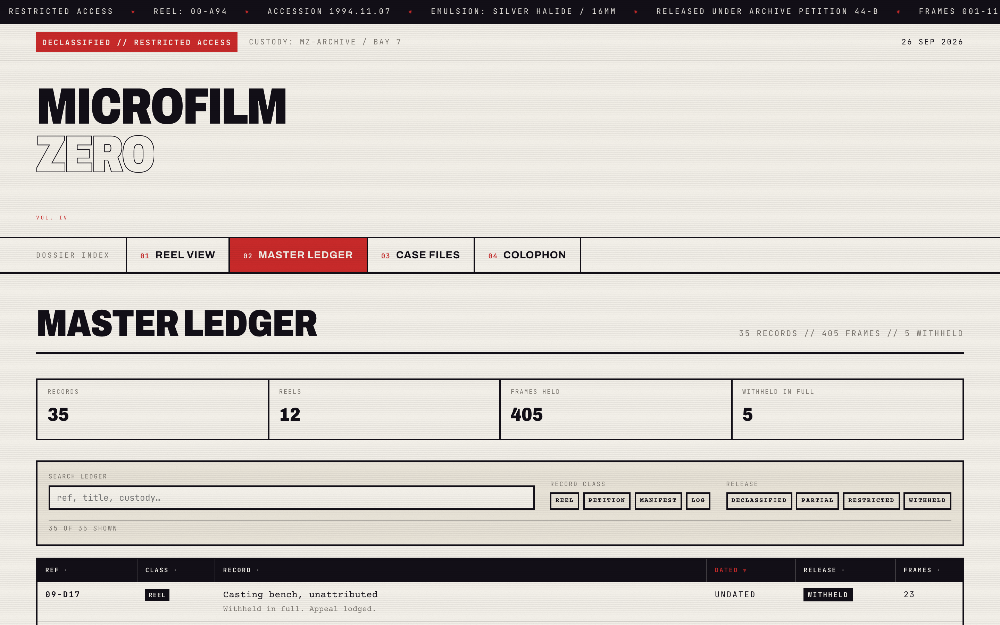
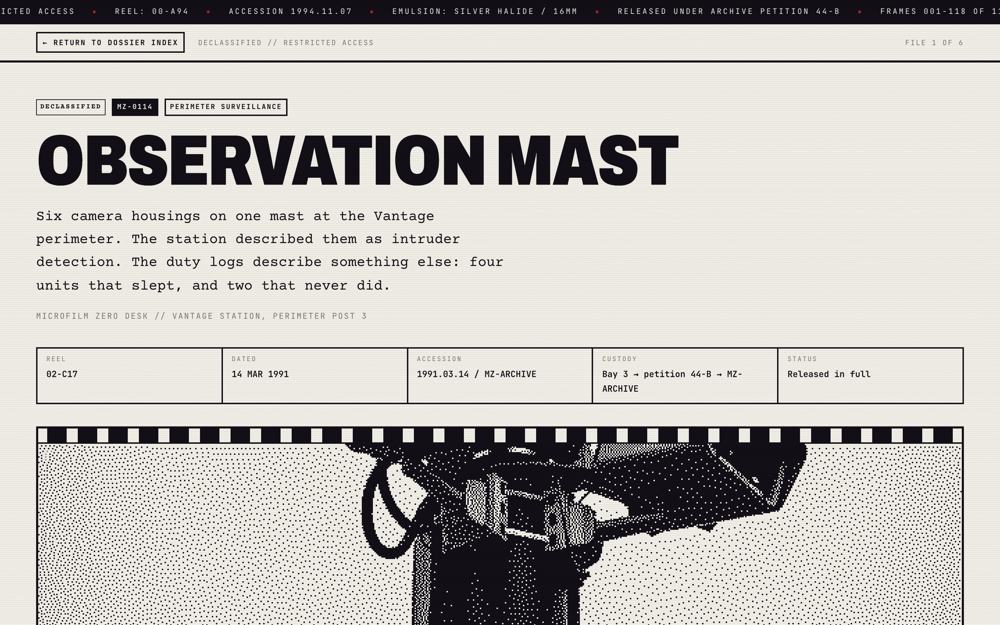
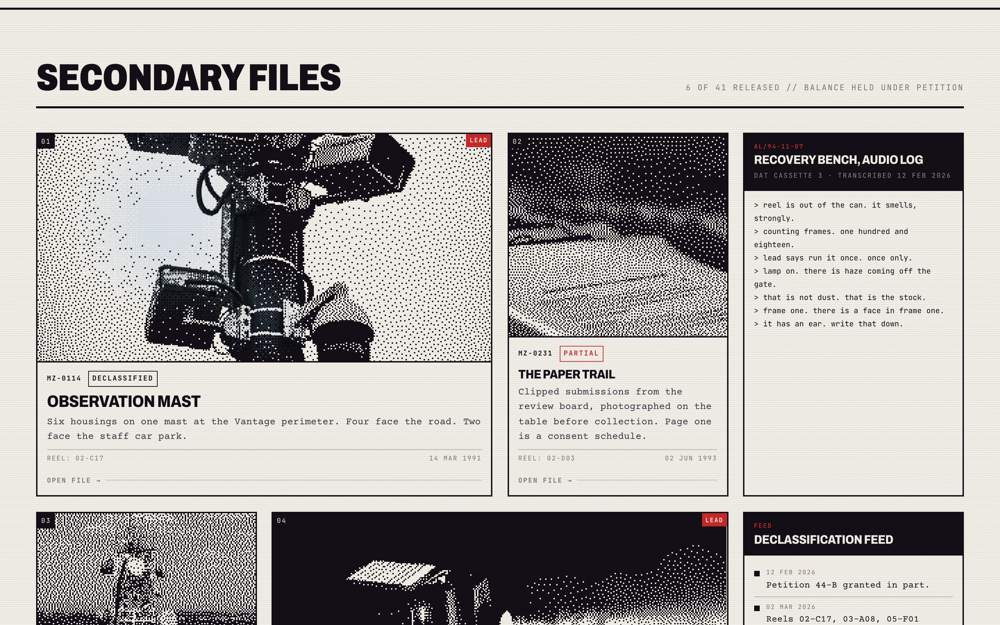
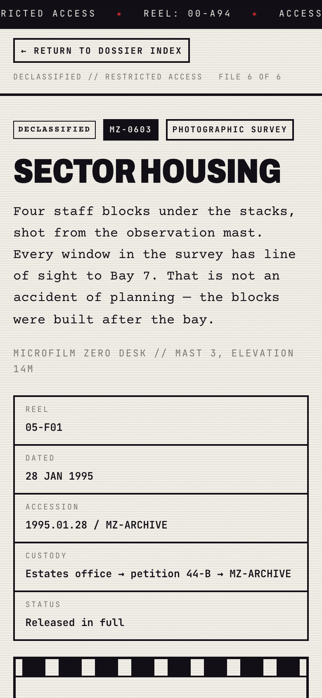

<div align="center">


# Microfilm Zero

**Declassified Microfilm Archive & Unredaction Viewer**

An interactive investigative-archive platform, featuring a real-time Floyd–Steinberg
dither viewer that the cursor burns through to full colour, HUD telemetry instruments
and six long-form case files.

[](https://react.dev)
[](https://vite.dev)
[](https://developer.mozilla.org/docs/Web/API/WebGL_API)
[](https://motion.dev)
[](LICENSE)



</div>

> **This is fiction.** Vantage Station, reel 00-A94, the casting programme, the
> ministry's replies, the interview transcripts, the disposal manifests and every
> record in the ledger were written for this build. No part of it describes a real
> facility, a real programme or a real person. The photographs are stock images from
> Unsplash, recaptioned to serve the story. Nothing here should be quoted as a source.

## ✨ Highlights

- **Photographs you have to uncover.** Every image is printed as a 1-bit Floyd–Steinberg
  dither. Drag across it and the cursor burns through to full colour, then the dither
  knits back cell by cell behind you.
- **Three optical targets, one carriage.** Switch between the head cast, the perimeter
  fence and the relay dish. Each carries its own headline, spec sheet, telemetry baseline
  and six reticle marks, so the whole instrument re-points — through a CRT glitch, held
  until the incoming plate is cached.
- **Instruments that do something.** Live optical density, halide decay, signal drift and
  lamp temperature; an exposure control that drives the dither grain and reveal radius on
  the running shader without remounting it.
- **An interactive transcript.** Select a field note and a crosshair lands on the detail it
  cites — on the ear, on the dispersion across the jaw — tracking the photograph rather
  than the frame as the viewport changes.
- **Six long-form case files.** 800–890 words each, with evidence logs, teletype transcripts,
  halftone plates, margin annotations and redactions you lift by clicking.
- **A searchable ledger.** 35 records across reels, petitions, disposal manifests and station
  logs, filterable by class and release, sortable by any column.
- **Built to be kind to devices.** WebGL contexts are created only as modules reach the
  viewport and capped at seven; every animation collapses to its finished state under
  `prefers-reduced-motion`, including the drifting telemetry.

## 📸 Tour

| The HUD | Bento grid |
| :---: | :---: |
|  |  |
| **Master ledger** | **Case file** |
|  |  |
| **Targeting loupe** | **On your phone** |
|  |  |

## 🚀 Run it on your computer

You need [Node.js](https://nodejs.org) **20 or newer** (check with `node -v`).

```bash
git clone https://github.com/claudiu1910/microfilm-zero.git
cd microfilm-zero
npm install
npm run dev
```

Vite prints the URL it picked — usually **http://localhost:5173**, or the next free port.
Edits show up in the browser instantly.

| Command | What it does |
| --- | --- |
| `npm run dev` | Starts the development server with live reload |
| `npm run build` | Creates an optimized production build in `dist/` |
| `npm run preview` | Serves that production build |
| `npm run lint` | Checks the code with oxlint |
| `npm run verify` | Runs 66 behavioural checks in headless Chrome |
| `npm run shots` | Regenerates the screenshots in `screenshots/` |

`verify` and `shots` drive a real Chrome and need the dev server already running:

```bash
npm run dev
SITE=http://localhost:5173 npm run verify
```

## 🌍 Deploy your own copy

`npm run build` produces a static `dist/`. Because routing uses `BrowserRouter`, the host
must fall back to `index.html` or a deep link like `/files/mz-0114` returns a 404.
`vercel.json` and `public/_redirects` are already in the repo, so Vercel and Netlify handle
that without further setup.

## The component

`<DitherVeil />`, JS-CSS variant, from the React Bits registry.

- Docs: <https://reactbits.dev/animations/dither-veil>
- Registry: <https://reactbits.dev/r/DitherVeil-JS-CSS.json>

The registry install command is:

```bash
npx shadcn@latest add @react-bits/DitherVeil-JS-CSS
```

This project is plain Vite + CSS with no `components.json`, so rather than
initialising shadcn just to place two files, the same registry JSON was fetched
directly and its contents written verbatim to:

- `src/components/DitherVeil.jsx`
- `src/components/DitherVeil.css`

Both files are byte-identical to the registry payload — treat them as vendored
and re-fetch rather than edit. The registry's one dependency, `ogl@^1.0.11`, is
installed in `package.json`.

## Hero configuration

The featured frame uses the specified configuration exactly
(`src/components/Hero.jsx`):

```jsx
<div style={{ width: '100%', height: '600px', position: 'relative' }}>
  <DitherVeil
    inkColor="#120f17"
    linger={1}
    paperColor="#f4f1ea"
    pattern="floyd"
    pixelSize={2}
    revealRadius={200}
    softness={0.6}
    src={HERO_SRC}
  />
</div>
```

`HERO_SRC` is the Unsplash URL from the spec, lifted into `src/data/dossier.js`
so the field-note markers can share it.

Numeric props are passed as JSX expressions (`linger={1}`) rather than the
strings in the original snippet (`linger="{1}"`). The component does arithmetic
on these values, so a string would propagate `NaN` through the shader uniforms.

## Two integration notes

**Images are preloaded before the component mounts.** `DitherVeil` only paints
its photo if the image finishes loading while the element is on screen — its
internal `wake()` is a no-op while an IntersectionObserver reports the canvas as
hidden, and a load that lands during that window leaves the canvas blank. The
archive cards originally mounted 300px ahead of the viewport and the second row
rendered solid black for exactly this reason. `useImageReady` now warms the
browser cache first and the component mounts only once the bitmap is decoded, so
its own request resolves immediately.

**Each instance costs a WebGL context.** `useInView` defers mounting a card's
veil until the card actually intersects the viewport. The page holds seven
contexts at most — one hero, six cards.

## Routes

`react-router-dom` with `framer-motion` page transitions (`AnimatePresence`,
`mode="wait"`), so the outgoing page sinks out of the gate before the next rises
into it.

| Route | Page |
| --- | --- |
| `/` | `pages/Home.jsx` — dossier hub: masthead, HUD viewer, bento grid, colophon |
| `/archive` | `pages/Archive.jsx` — master ledger, 35 records, filterable and sortable |
| `/files/:id` | `pages/Article.jsx` — one of six case reports, addressed `mz-0114` … `mz-0603` |
| `/file/:slug` | Redirects to the `/files/:id` equivalent so older links survive |

`BrowserRouter` means a static host must fall back to `index.html` or a deep
link 404s. `public/_redirects` covers Netlify and `vercel.json` covers Vercel;
Vite's dev server and `vite preview` already do it.

## The six case files

Each file page runs 800–890 words across three sections and carries the same
apparatus: two interactive/halftone plates, two evidence logs, two teletype
transcripts, a boxed sidebar, margin annotations, liftable redactions and two
cross-references. Content lives in `src/data/articles.js`.

| File | Route | Words | Subject |
| --- | --- | --- | --- |
| MZ-0114 | `/files/mz-0114` | 887 | Perimeter mast — duty cycles, registration transcription, the blank sixth column |
| MZ-0231 | `/files/mz-0231` | 824 | Destroyed consent schedules, the surviving memo, the incinerator weight log |
| MZ-0307 | `/files/mz-0307` | 804 | Bearing 041, traffic correlation, a forestry track recorded as closed |
| MZ-0442 | `/files/mz-0442` | 824 | Acetate hydrolysis, what one inspection run cost the reel |
| MZ-0519 | `/files/mz-0519` | 837 | 214 pinholes, the provenance dispute, screw-centre comparison |
| MZ-0603 | `/files/mz-0603` | 814 | Sight lines, allocation outside the points scheme, the roof voids |

Blocks are rendered by `components/ArticleBody.jsx` from a small tagged union:
`h`, `p`, `pull`, `note`, `side`, `transcript`, `evidence`, `plate`. Evidence
rows key on label *and* index — row labels are prose and may legitimately
repeat, which caused a duplicate-key warning when two rows in the screw-centre
log read the same.

## HUD

| Widget | File |
| --- | --- |
| Optical target switcher (3 targets, CRT glitch on change) | `components/hud/TargetSwitcher.jsx`, `CrtGlitch.jsx` |
| Microfiche telemetry bar (density, decay, drift, lamp temp) | `components/hud/TelemetryBar.jsx`, `hooks/useTelemetry.js` |
| Exposure control — live dither grain and reveal radius | `components/hud/ExposureSlider.jsx` |
| Coordinate loupe, `REL-LOC: [x, y]` | `components/Loupe.jsx` |
| Contact sheet of the three targets, under the gate | `components/hud/ContactStrip.jsx` |

Switching target is not a picture swap. Each entry in `data/targets.js` carries
its own headline, case number, spec sheet, telemetry baseline, bearing/range and
its own six reticle marks, so the viewer, the notes panel and the instruments
all re-point together. The switch is held until the interference has run *and*
the incoming plate is cached, capped at 3s so a dead image cannot strand the
viewer mid-change.

Under the gate sit a horizontal spec strip and a contact sheet of all three
targets. Those are load-bearing, not decoration: the notes panel runs ~1,000px
and on the landscape target the plate column finished several hundred pixels
short of it, leaving a dead area beside the notes. The two blocks close that to
within 30px and the contact sheet doubles as a second way into the switcher.
Its thumbnails are plain `` with a CSS halftone — a live veil each would
cost three more WebGL contexts.

The exposure sliders drive `pixelSize` and `revealRadius` directly. `DitherVeil`
re-reads its settings on every render and wakes its own loop, so the grain
changes without remounting the WebGL context — only `src` does that.

## Bento grid

Nine modules on a four-column grid, spans set explicitly so each row closes:
2+1+1, then 1+2+1, then 1+2+1. Two 2x2 leads carry taller live `<DitherVeil />`
previews; the rest are case cards plus three telemetry modules — a typed audio-log
transcript, a declassification timeline, and a block of liftable redactions.
Entry is a framer-motion stagger, collapsed to a plain appearance under reduced
motion.

The audio log is text only. It types itself out but plays no sound — nothing on
the page should start making noise on its own.

### Finding the way in

Every file module is one hit area, but that needs saying visually or the card
reads as an illustration. On hover and on keyboard focus the title takes the
stamp colour and grows a crimson underline, an `OPEN` tab slides up from the
bottom of the frame, the `OPEN FILE →` cue brightens and tracks out, and the
whole module carries `cursor: pointer`. The cue is present at rest in drafting
grey rather than appearing only on hover, so the card is legibly a link before
you touch it.

## File page layout

`.file__body` is a two-column grid — the prose block (text measure plus its
margin-note column) and a sticky rail — centred so the page fills the viewport
instead of leaving a third of it empty. The rail carries a contents list with
scroll-spy (`hooks/useActiveSection.js`), five key figures per file, the
release stamp and custody chain, and links to the two cross-referenced files.
Section headings get stable anchors from `lib/headings.js`, which is what the
contents list jumps to. Below 1240px the rail unsticks and flows under the
prose as a row of boxes.

## Mechanical animations

| Effect | Where |
| --- | --- |
| Redaction strip lifting off headlines | `components/RedactionWipe.jsx`, `.wipe` |
| Metadata decryption scramble, ~350ms | `components/Scramble.jsx` |
| Projector gate snap — carriage, rails, reticles | `.plate.is-seated`, `gate-snap` |
| Teleprinter stream + blinking caret | `FieldNotes.jsx`, `ArticleBody.jsx`, `AudioLogModule.jsx` |
| Scanlines, lamp sweep, paper grain | `.reader` overlay in `App.jsx`, `body::after` |
| CRT tear / RGB split on target change | `.crt` |
| 100ms negative-inversion exposure on navigation | `components/FlashTransition.jsx` |

Everything is gated on `useReveal` (IntersectionObserver) so effects fire as
sections are reached, and on `useReducedMotion` so they collapse to their
finished state when the user asks for less motion — including the telemetry
readouts, which hold at their baseline rather than drifting.

Three implementation notes worth keeping:

`useReveal` uses a **zero** root margin. An earlier negative inset left the hero
headline concealed at rest whenever it sat just under the fold.

`Redacted` is a `<span role="button">`, not a `<button>`. A button always
establishes its own formatting context, so a lifted passage could not rewrap
inside its paragraph and sat there as a centred block.

`.wordmark__link` is a grid. `.wipe` is `inline-block`, which otherwise won
on source order and ran the two wordmark lines together on one line.

## Design system

| Token | Value | Use |
| --- | --- | --- |
| `--paper` | `#f4f1ea` | Vintage document stock |
| `--ink` | `#120f17` | Carbon black type |
| `--stamp` | `#c92a2a` | Classified crimson — stamps, reticles, meters |
| `--grey` | `#7d7871` | Drafting grey — secondary metadata |
| `--display` | Archivo | Heavy grotesque mastheads |
| `--report` | Courier Prime | Typewriter serif report body |
| `--mono` | JetBrains Mono | Tabular logs, telemetry, data stamps |

Courier Prime is a genuine typewriter serif and carries the dossier voice, but
it runs narrow and reads slower than a text serif at length. The article measure
is held to 62ch with a 1.78 line-height to compensate; if long-read comfort ever
outweighs the period look, swapping `--report` is a one-line change.

## Verification

`screenshots/verify.mjs` drives headless Chrome (WebGL via SwiftShader) over the
running dev server and asserts 40 checks: target switching re-points the viewer,
metadata and reticles together; the exposure sliders drive the live component
without remounting it; telemetry drifts while running and holds under reduced
motion; the bento grid mounts all six previews; every route renders its full
apparatus; the ledger filters, sorts and exposes `aria-sort`; and every animation
collapses when reduced motion is requested.

```bash
npm run dev
SITE=http://localhost:5173 npm run verify
```

## Image credits

All photographs are from Unsplash and are hot-linked at their CDN URLs. The
narrative around them — Vantage Station, reel 00-A94, the field notes — is
fiction written for this build.
